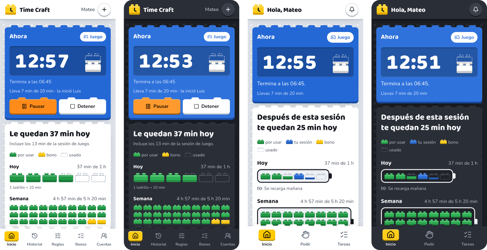

<p align="center">
  <picture>
    <source media="(prefers-color-scheme: dark)" srcset="apps/web/brand/logo-dark.svg">
    
  </picture>
</p>

<p align="center">
  El tiempo de pantalla de un niño, armado y gastado en ladrillos.<br>
  Cuotas diarias y semanales que los padres y el niño ven igual, desde cualquier teléfono.
</p>

<p align="center">
  
</p>

## Qué es

Time Craft lleva la cuenta del tiempo de pantalla de un niño de 9 años (Minecraft en la PC y YouTube en una TV) con una bolsa de tiempo por día y por semana, como créditos. Lo usan los dos padres y el niño, cada uno desde su teléfono o su navegador y desde cualquier lugar.

No es un control parental que espía ni bloquea: no detecta el juego ni la TV. Es una cuenta compartida y transparente. Los padres registran las sesiones, el servidor lleva el cronómetro y todos ven exactamente los mismos números y las mismas reglas.

Cada ladrillo vale 10 minutos. Un ladrillo sólido es tiempo que todavía queda, uno punteado es tiempo que ya se usó, y el que está en uso se va vaciando desde arriba.

## Cómo se usa

**Padres** (`/padres`)

- Ven de un vistazo qué está corriendo y cuánto le queda al niño hoy y en la semana.
- Inician una sesión ahora o más tarde en el día, y la pausan o la detienen con un toque.
- Responden lo que pide el niño (empezar o tiempo extra) y aprueban las tareas que reporta.
- Definen las reglas: límite diario y semanal, límites propios por actividad, tope de bonos y aviso previo.
- Revisan el historial de cada semana y administran las cuentas.

**El niño** (`/nino`)

- Entra con su usuario y un PIN.
- Ve su saldo como baterías de ladrillos y la cuenta regresiva de su sesión.
- Pide tiempo armando ladrillos, sin teclear números, y gana bonos haciendo tareas.
- Nunca inicia, pausa ni detiene nada: pide, y mamá o papá deciden.

**Avisos.** Llegan por push al teléfono aunque la app esté cerrada: el aviso antes del final, el fin, una sesión cerrada sola, los pedidos y los reportes de tareas. Con la app abierta, además suena y vibra.

**Tema claro y oscuro.** Sigue al del teléfono o la computadora, y cada dispositivo puede fijar uno en Cuentas (padres) o en Avisos (niño).

## Cómo funciona

- **El servidor manda.** El cronómetro vive en la api; las pantallas solo cuentan el restante en vivo con la hora del servidor.
- **El saldo no se guarda.** Se calcula siempre a partir de las sesiones, los bonos y la política vigente.
- **Alarmas sin cron.** El aviso previo, el fin, el inicio programado y el cierre automático se programan en Upstash QStash, que llama de vuelta a la api en el segundo exacto.
- **Todo en planes gratuitos**: Vercel Hobby, Neon Free y QStash Free.

## Stack

- [Bun](https://bun.sh) y [Turborepo](https://turbo.build) para el monorepo.
- **api**: [Hono](https://hono.dev) en Vercel, [Better Auth](https://www.better-auth.com), PostgreSQL en [Neon](https://neon.tech) con [Drizzle](https://orm.drizzle.team), QStash y Web Push.
- **web**: [Astro](https://astro.build) estático con islas React y [Tailwind CSS](https://tailwindcss.com); fuentes Baloo 2 y Nunito.
- [Biome](https://biomejs.dev) para lint y formato; `bun test` para los tests.

```
apps/
  api/        Hono en Vercel: rutas, auth, adaptadores (Drizzle, QStash, Web Push)
  web/        Astro + islas React + Tailwind; el logo vive en apps/web/brand/
  e2e/        Playwright: el flujo de punta a punta y el smoke test de producción
packages/
  core/       dominio, casos de uso y puertos
  db/         schema Drizzle, migraciones, cliente y seed
  tsconfig/   configuraciones de TypeScript compartidas
```

## Empezar en local

```sh
bun install
cp .env.example .env    # complétalo: la lista completa de variables está ahí
bun run db:migrate      # aplica las migraciones en DATABASE_URL_UNPOOLED
bun run db:seed         # crea la familia, los padres, el niño y las reglas iniciales
bun run dev             # web en http://localhost:4321 y api en http://localhost:3000
```

Otros comandos:

```sh
bun run lint            # Biome en todo el repo
bun run typecheck       # tsc en paquetes y api; astro check en la web
bun run test            # tests con bun test
bun run build           # web → apps/web/dist, api → apps/api/dist
bun run e2e             # los 8 pasos del flujo con Playwright (ver apps/e2e/CLAUDE.md)
bun run --cwd apps/web brand   # regenera el logo y los iconos desde apps/web/brand/mark.svg
```

## Logo

El logo es un ladrillo amarillo 2×2 con la aguja de un reloj. `apps/web/brand/mark.svg` es la fuente; `bun run --cwd apps/web brand` genera a partir de él:

- `apps/web/brand/logo.svg` y `logo-dark.svg`: la marca con el nombre en trazos, para fondo claro y oscuro;
- `apps/web/public/favicon.svg` y `favicon.ico`;
- los iconos de la app, el adaptable de Android, el de Apple y la silueta de los avisos push, en `apps/web/public/icons/`.

## Despliegue y documentación

- [docs/contexto-v1.md](docs/contexto-v1.md): qué hace la versión 1 y por qué (la fuente de verdad del producto).
- [docs/timecraft_v1.sql](docs/timecraft_v1.sql): el schema de referencia.
- [docs/deploy.md](docs/deploy.md): Vercel, Neon, QStash, el primer despliegue y cómo correr el e2e contra dev.
- [docs/verificacion-manual.md](docs/verificacion-manual.md): lo que se revisa a mano en teléfonos reales antes de cada release.
- Cada app y paquete tiene su `CLAUDE.md` con lo que hace y lo que no debe hacer, y el diseño se describe en [apps/web/DESIGN.md](apps/web/DESIGN.md).

Un PR por fase desde `dev`; un release es un PR de `dev` a `prod`. Cada release calcula la versión de la web y la de la api a partir de los commits (semantic-release), con su tag, su `CHANGELOG.md` y su GitHub Release.
